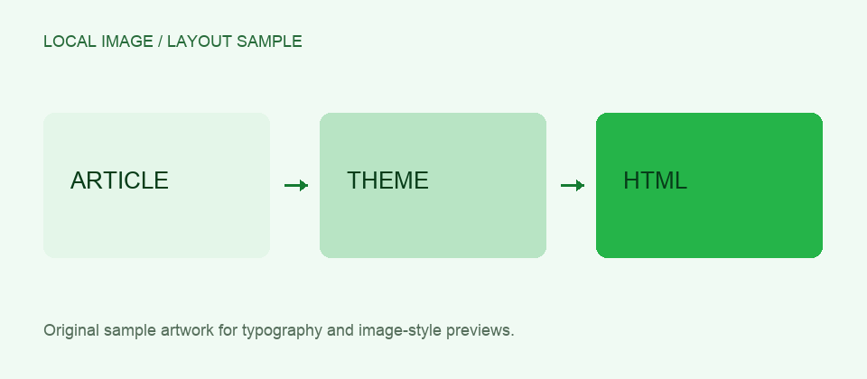

# 绿色系列主题：完整组件样稿

这篇样稿保留参考系列的排版结构，以 #25b449 为主色重新配色，并同步调整深色文字、浅色背景、边框与代码块。绿色系列仅保留标准版，运行渲染脚本时默认使用。

## 二级标题：章节的开始

标准版采用绿色渐变、白字和居中的短标题。段落使用 16px 正文、较宽行距与字距，给信息密集的长文留出阅读空间。

### 三级标题：浅绿底与竖线

三级标题延续参考文章的结构，改用浅绿背景与绿色竖线。正文可以使用 **标准绿色加粗**，也可以选择 <strong class="emphasis-marker">浅底高亮强调</strong>、<strong class="emphasis-underline">下划线强调</strong> 和 <strong class="emphasis-neutral">深灰加粗</strong>。

#### 四级标题：绿底标签

四级标题适合案例名称、单项实验和提示词小节。它与二、三级标题保持清楚的层级差异。

<h3 class="heading-plain">同级标题选项：纯文字</h3>

适合希望让标题装饰更少的段落。

<h3 class="heading-underline">同级标题选项：细下划线</h3>

用一条细线分隔小节，保持文字左对齐。

<h3 class="heading-band">同级标题选项：浅底色带</h3>

保留原文系列的浅绿底色与竖线。

<h3 class="heading-badge">同级标题选项：实色标签</h3>

标题样式可以单独选择，无须更换整篇文章的主题。

## 图片：三种展示方式

### 默认图片



### 原图、细框与轻阴影

<figure>
  
  <figcaption>原图：没有边框、圆角和阴影。</figcaption>
</figure>

<figure>
  
  <figcaption>细框：浅绿描边与内部留白。</figcaption>
</figure>

<figure>
  
  <figcaption>轻阴影：来自第一篇参考文章的图片处理方式。</figcaption>
</figure>

## 引用与提示信息

### 普通引用

> 引用适合补充说明、摘录或与正文区分的观点。这里使用原创示例文字，不复用参考文章的内容。
>
> 多段引用之间保留适当的间距。

### 带用途的提示块

> [!NOTE]
> 提示：展示帮助读者理解上下文的补充信息。

> [!TIP]
> 小技巧：将较长的操作拆成几个可直接执行的步骤。

> [!IMPORTANT]
> 重点：这里放需要读者记住的一个结论。

> [!WARNING] 操作前检查
> 注意：覆盖文件前先核对输出位置。

> [!CAUTION]
> 警告：清楚写出不可恢复操作的后果。

> [!PROMPT]
> 提示词也可以写成普通段落，保留 **强调** 和列表等富文本结构。

## quote-block：提示词与程序片段

### 提示词块

标准版保留参考文章中 10px 的提示词字号，也可以通过自定义 CSS 调整。

```prompt
创建一张用于文章排版预览的示意图。
画面使用绿色、浅灰与白色，信息清楚，留白充分。
三个区域分别表示原稿、主题与导出结果。
图中文字简洁，不加入品牌标志或额外说明。
```

### Markdown

```md
## 章节标题

这是一段 **加粗文字**。

- 第一项
- 第二项
```

### JavaScript

```js
const article = {
  title: "一篇示例文章",
  theme: "irene-green",
}

console.log(article.title)
```

### TypeScript

```ts
interface Theme {
  name: string
  files: string[]
}

const theme: Theme = {
  name: "irene-green",
  files: ["irene-green.css"],
}
```

### JSON

```json
{
  "theme": "irene-green",
  "preview": true
}
```

### Shell

```bash
bun scripts/main.ts article.md --theme irene-green
```

### Python

```python
themes = ["绿色标准版"]
for theme in themes:
    print(theme)
```

### HTML 与 CSS

```html
<strong class="emphasis-marker">重点内容</strong>
```

```css
#nice h3 {
  color: #25b449;
}
```

### YAML 与纯文本

```yaml
theme: irene-green
output: preview.html
```

```text
这是一段需要原样保留换行的文字。
它不会作为 Markdown 再次解析。
```

## quote-inline-block：行内选项

普通行内代码可以直接写成 `theme.name`。需要区分用途时，可以使用 <code class="inline-kbd">Cmd + K</code> 表示快捷键、<span class="quote-inline-block inline-tag">提示词</span> 表示标签，或用 <span class="quote-inline-block inline-muted">补充说明</span> 降低视觉强调。

较长的行内代码也会换行，例如 `https://example.com/articles/theme-preview?mode=compact&language=javascript`，可观察窄屏下的边框和底色是否连续。

## 列表与表格

- 先选择整篇文章的主题。
- 再按需要调整某个组件。
  - 标题保持原有语义层级。
  - 图片与说明文字保持对应。
- 最后检查手机宽度下的换行。

1. 准备原稿。
2. 生成本地预览。
3. 核对内容与图片。

| 主题 | 标题 | 提示词字号 | 适合的阅读节奏 |
| --- | --- | --- | --- |
| 标准版 | 渐变章节与浅底小节 | 10px | 保留参考文章布局 |

---

样稿结束。图片在预览中真实显示，粘贴正文仍通过标记和上传清单交付。
